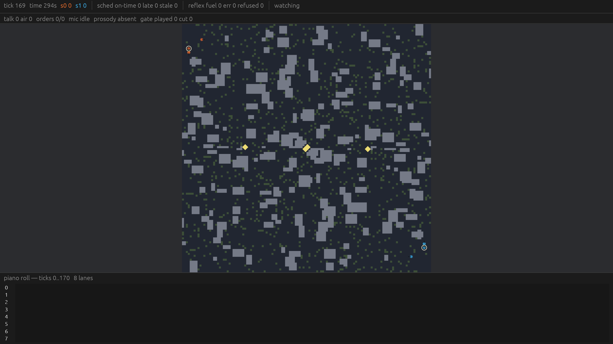
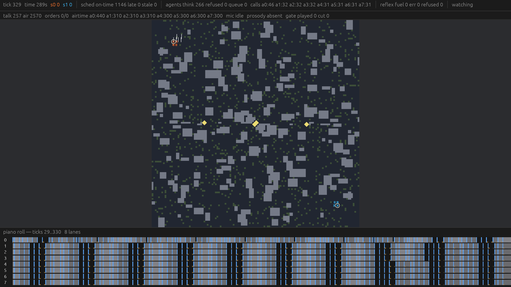
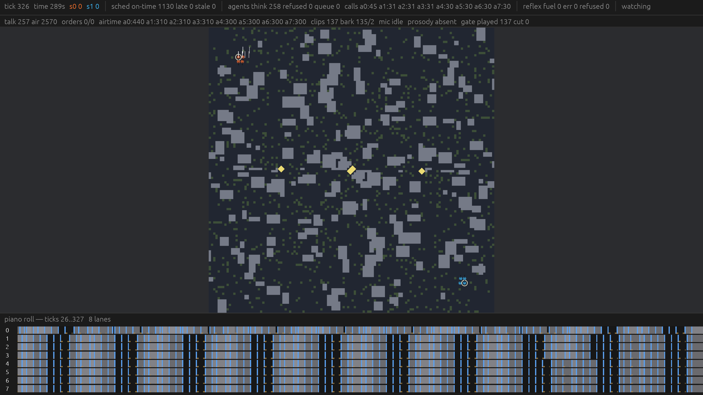
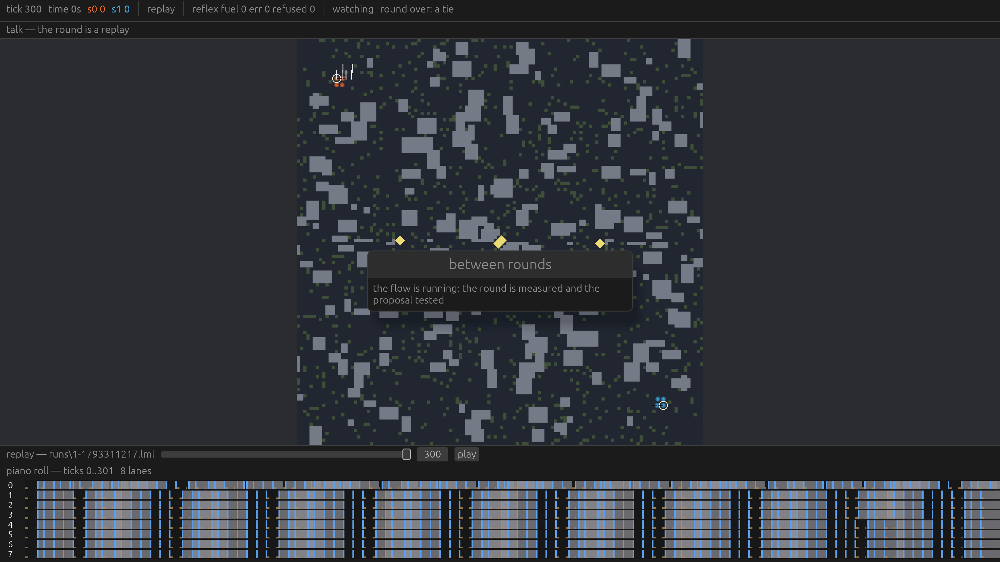
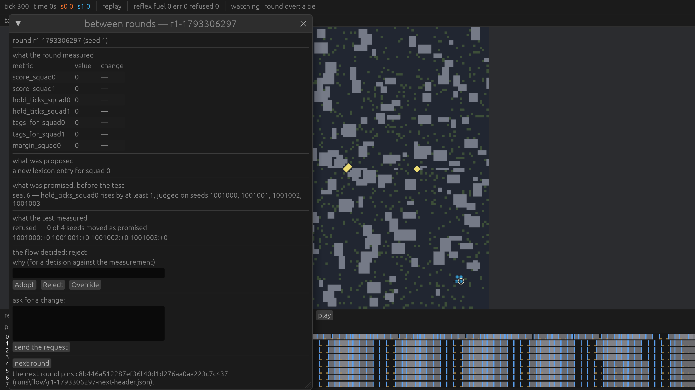
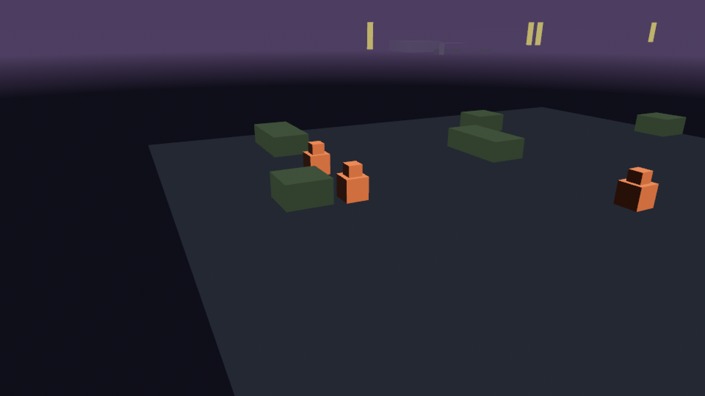
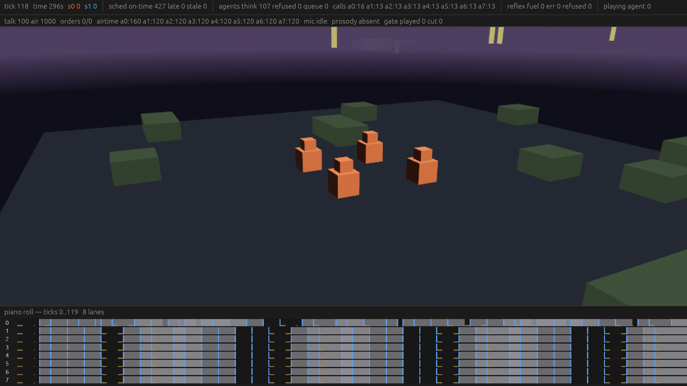
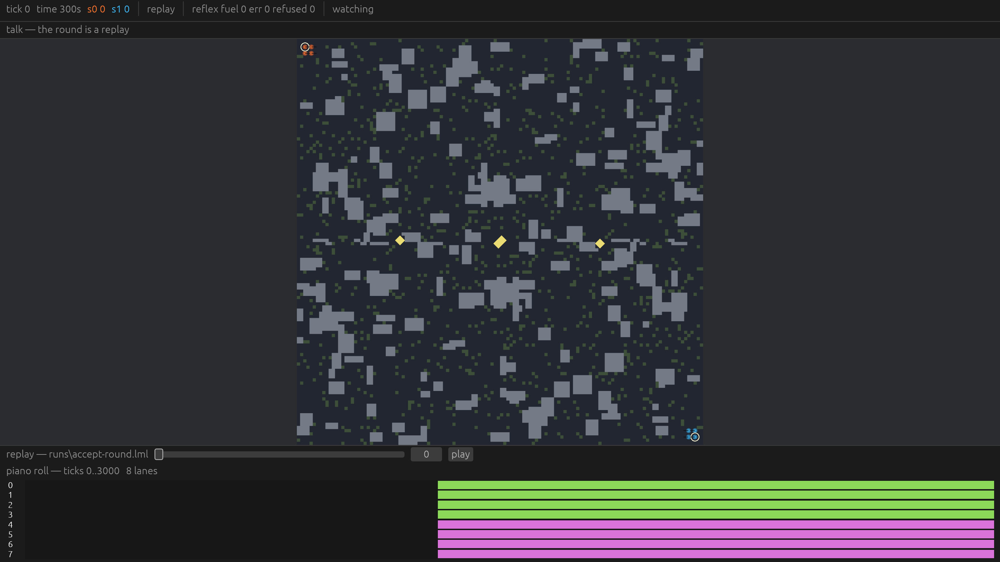

# Acceptance — Milestone 1, by hand

This is Casey's ~20-minute pass over M1 on the ProArt. Every section is one
phase; every step is the command to run, what to do with keys and clicks, and
what counts as a pass or a fail. Each section was machine-verified on this
machine (Windows exe, screenshot mode); the shot linked in the section is what
the pass looked like.

- **Build (WSL, once, ~10 min):** `bash scripts/win-build.sh build -p lm-host -p lm-tools --release`
- **Then, in PowerShell:** `cd C:\Users\casey\src\last-mile-build-accept`
  (the mirror `win-build.sh` keeps for this worktree — one per worktree
  directory name; rebuilds after that are seconds).
- **The two exes:** `.\target\release\lm-host.exe` (the game) and `.\target\release\lm.exe` (the CLI). Every command below runs from that directory.
- Every round the host plays is recorded to `runs\<seed>-<unix-secs>.lml` and the path is printed when the round ends.

## 1. The 2D map, the piano roll and the HUD (phase 2)



1. **Run it.** `.\target\release\lm-host.exe`
   (defaults: seed 1, window 1280×720, the 2D view, `--agents off`, `--talk off`).
2. **Watch ~10 s.** *Pass:* a window titled **last-mile**; the top bar reads
   `tick N time Ns s0 X s1 Y | sched on-time … late … stale … | reflex fuel … err … refused … | watching`
   and the tick climbs at 30 Hz (300 ticks ≈ 10 s); under it a second row of
   talk counters, all zero with `--talk off`; the map shows squad-coloured
   discs (one squad cyan-green, the other warm), diamond beacons and walls —
   the whole board is visible while you merely watch (the authority's view);
   the bottom panel reads `piano roll — ticks A..B` and `8 lanes`.
   *Fail:* any of those missing, or the tick stalls or jumps.
3. **Play.** Press `1` (possess agent 0 — keys `1`..`8` are agents 0..7).
   The bar's last word becomes `playing agent 0`, the camera follows the
   agent, and the map closes down to that agent's fog of war. Click a
   walkable cell: the agent walks there and a **bright green mark** (the
   human's decision) appears on its lane. Press `H`: it holds.
   *Fail:* clicks do nothing, or the agent moves without a mark appearing.
4. **Camera.** `0` (or `Esc`) lets go — the bar says `watching` again. Now
   `WASD` / left-drag pans, the wheel zooms, `F` with the pointer over an
   agent follows it (`watching agent N`), `Tab` toggles back to the last
   agent you played. *Fail:* the camera is stuck while merely spectating.
5. **Shut it down.** Close the window mid-round. *Pass:* the console prints
   `lm-host: recorded runs\1-<secs>.lml` — whatever was played is on disk.

## 2. Agents thinking (phase 3)



1. **The stub.** `.\target\release\lm-host.exe --agents stub`
   *Pass:* the console says `lm-host: the agents think with the stub model`,
   and within a few seconds the HUD grows a middle section:
   `agents think N refused N queue N` and `calls a0:… a1:… … a7:…`, all
   climbing (~1 thought per agent per second; the shot above caught
   `agents think 78 … calls a0:10 … a7:10`). The piano roll shows **blue
   marks** (System One decisions) with thin **amber bars** under them (the
   question asked → the answer landing). *Fail:* the counters never move, or
   `refused`/`queue` grows without bound.
2. **The Thor.** `.\target\release\lm-host.exe --agents thor`
   Needs the Thor up on the LAN (`http://192.168.0.78`, d1-2B on port 8094).
   *Pass:* console `lm-host: the agents think with the thor model`, the same
   HUD counters climbing on real answers (verified: `agents think 66 …
   calls a0:9 … a7:9` at tick 372). Without a cloud key the console also
   prints `the cloud tier is not available: … secrets file …` — that line is
   expected on a machine without `C:\Users\casey\.config\last-mile\secrets.env`;
   the Thor tier is unaffected. *Fail:* `thinks` stalls or `refused` climbs
   (Thor down or wrong ports) — check the Thor before blaming the host.

## 3. Talk (phase 4)



1. **The round talks.** `.\target\release\lm-host.exe --agents stub --talk stub`
   (talk needs agents: lines come out of the thinking gates). *Pass:* console
   `lm-host: the round speaks with the stub voice`; within seconds the second
   HUD row fills, e.g. the shot above:
   `talk 257 air 2570 orders 0/0 airtime a0:440 … clips 137 bark 135/2 mic idle prosody absent gate played 137 cut 0`.
   The lanes of the piano roll grow long **channel-coloured spans** (a line
   being spoken), and words appear on the map by the speaker. *Fail:* the
   talk row stays empty with `--talk stub` and agents on.
2. **Push-to-talk (the key is `V`).** Press `1` to possess an agent. Hold
   `V`, say anything (the stub ASR always hears "hold" — silence works too),
   release. *Pass:* the agent speaks the line — a channel-coloured span runs
   on its piano-roll lane and the word appears on the map by it — a **bright
   green mark** lands on the lane (the human's decision, logged and hashed
   like any other), and the talk row moves: `talk`/`air`/`airtime a0:` climb
   and `mic` reads `live` after the first capture. (The line is an order with
   no beacon named, so it stays a spoken line — nobody re-paths.) Press `V`
   while possessing nobody: the red status `play an agent before you talk to
   it` appears in the top bar. *Fail:* no line, no mark, no status.
3. **The half-duplex cut.** While an agent's clip is playing (the `gate
   played N` counter climbing), press and hold `V`: the voice cuts off
   mid-word, and the row reads `gate played N cut M` with `cut` climbing —
   the dropped clip is gone for good, never queued. *Fail:* agents talk over
   you, or `cut` never moves.

## 4. A round ends into the between-round screen (phase 5)





1. **Play a short round.**
   `.\target\release\lm-host.exe --agents stub --ticks 300 --learn-ticks 300`
   (`--ticks 300` makes the round 10 s instead of 5 minutes so acceptance
   stays quick; `--learn-ticks 300` keeps the flow's own headless round short).
   *Pass:* the round ends at tick 300 — the bar says `round over: a tie`, the
   console prints `lm-host: recorded runs\1-<secs>.lml`, and the app reopens
   its own log (the bottom panel says `replay — runs\…`, the bar says `replay`).
   The same moment a small card opens over the middle of the map —
   **`between rounds` / `the flow is running: the round is measured and the
   proposal tested`** (the shot below), and the console prints
   `lm-host: the learning flow is running (…)`. The flow takes ~1.5–2 s at
   `--learn-ticks 300` (the first one in a fresh `runs\` tree can take
   ~10–15 s while the disk and the scanner warm up), and when it answers the
   card is replaced by the real window: **`between rounds — r1-<stamp>`**.
   Closing the window while the flow runs is safe now: the app waits for the
   flow (`the learning flow is still running; it finishes before the app
   closes`) so the chain on disk is whole — try it once if you like.
2. **Read the screen in order — the promise before the verdict.** *Pass:* top
   to bottom you find `round r1-… (seed 1)`; **what the round measured**
   (a grid of metrics with value and change, e.g. `hold_ticks_squad0 | 5 | +5`);
   **what was proposed** (`a new lexicon entry for squad 0`, with a diff when
   there is one); **what was promised, before the test** (the sealed
   prediction: `seal 0 — hold_ticks_squad0 rises by at least 1, judged on
   seeds 1001000, …`); and only then **what the test measured** (`refused — 0
   of 4 seeds moved as promised` with per-seed deltas). The prediction must
   appear above the verdict. *Fail:* the verdict shown with no sealed
   prediction before it.
3. **The three calls.** The line `the flow decided: reject` sits over a
   reason box and three buttons: **Adopt / Reject / Override**. Click
   **Override** (a reason is optional — empty uses "a human overrode the
   flow's decision"). *Pass:* the note `the decision is now the human's`
   appears in green, and the ledger under `runs\ledger.jsonl` gains an
   override entry with your reason. Adopt/Reject confirm the flow's own call
   (`the change is adopted` / `the change is refused`).
4. **Ask, then next round.** Type into **ask for a change** and click **send
   the request** — *pass:* `the request is in runs\deposits\deposit-….md`.
   Click **next round** — *pass:* `the next round is under way`, the window
   closes, the bar's tick restarts from 0 (round N+1, pinned to the harness
   the flow left: `the next round pins … (runs\flow\…-next-header.json)`).
   *Fail:* the next round doesn't start, or starts from the old header.
5. (Optional, costs a cloud call) `--reviewer router` instead of the default
   `stub` sends the review to the cloud pool.

## 5. The 3D view and `B` (phase 6)



1. **Pure 3D.** `.\target\release\lm-host.exe --view 3d --possess 0`
   (no `render.toml` in the tree: the plan's defaults apply — 960×540 internal,
   integer upscale). *Pass:* a brief warmup card (a palette test that doubles
   as shader compilation, ~8 frames), the console prints `lm-host: the 3D view
   is warm; the round starts`, then a low-poly world: violet-grey sky, ground
   fog that eats the far edge, squad-coloured figures, box walls, and a
   beacon tower on the horizon (the shot above, camera on agent 0). There is
   **no** HUD and no piano roll in this layout — panels are the 2D
   layout's companions. WASD/drag pans, the wheel zooms, `F` follows the
   figure under the pointer. *Fail:* a mid-round stall after the card (that's
   the bug warmup exists to prevent), or no figures at all.
2. **Both.** `.\target\release\lm-host.exe --view both --agents stub --possess 0`
   *Pass:* it opens on the **3D** view with the HUD bar and the piano roll
   riding over it (the shot below: `tick 61 … agents think 16 … | playing
   agent 0` over the 3D world). Press **`B`**: the console prints
   `lm-host: the 2D map view draws (B flips it)` and the same round is now the
   2D map — same tick, same scores, same lanes; the round never restarts.
   `B` again flips back. Holding `V` here only talks (§3): the flip key and
   the talk key are two different keys, and a test in `keys.rs` fails the
   build if any two of the host's bindings ever share a key again.
   *Fail:* the flip resets or pauses the round, the panels vanish in one of
   the two views, or `V` flips the view.



## 6. Replay of a saved round (phase 2's viewer)



1. **Make a round.** `.\target\release\lm.exe run --seed 3 --ticks 3000 --out runs\accept-round.lml`
   *Pass:* console `seed 3: 3000 ticks, 100 hashes, 0 decisions (scores [861, 861])`
   and `wrote runs\accept-round.lml`.
2. **Open it.** `.\target\release\lm-host.exe --replay runs\accept-round.lml`
   *Pass:* the bottom panel reads `replay — runs\accept-round.lml` with a
   slider and a **play** button; the top bar has `replay` where the
   sequencer's counters were; the talk row reads `talk — the round is a
   replay`. Drag the slider: the world snaps to that tick (seeking back
   replays the round from its first tick — deterministic, so it lands on the
   same state). Click **play**: the round plays itself at its own 30 Hz and
   stops at the end. *Fail:* the slider doesn't move the world, or playback
   stutters at the wrong rate.
3. **A replay is watched, not played.** Possess a key (`1`) or click the map:
   the red status `a replay is watched, not played: scrub it instead`.
   *Fail:* any input changes the round.
4. **Hashes.** `.\target\release\lm.exe replay runs\accept-round.lml` →
   *pass:* `OK 100 hashes`.

## 7. The CLI: golden and learn (phases 1 and 5)

1. **Golden.** `.\target\release\lm.exe golden`
   *Pass:* exactly `OK 3/3` (the three pinned seeds in `tests\golden.toml`,
   played and hash-checked). *Fail:* `x/3 seeds match` — the core is not
   bit-stable on this machine.
2. **One learning round, headless.** Give the flow a harness of its own
   (one directory per agent):

   ```powershell
   New-Item -ItemType Directory -Force accept-harness\a0\reflexes | Out-Null
   Copy-Item assets\harness\default\*.toml accept-harness\a0\
   Copy-Item assets\reflexes\default.rhai accept-harness\a0\reflexes\
   .\target\release\lm.exe learn --seed 1 --harness accept-harness --runs accept-runs --ticks 900
   ```

   *Pass* (verified output on this machine):

   ```
   round r1 (seed 1)
     log:            accept-runs\flow\r1.log
     metrics digest: 836ce161f7fb1e8c
     proposal:       a new lexicon entry for squad 0
     prediction:     hold_ticks_squad0 up by at least 1
     seal:           0
     eval:           1001000:+0 1001001:+0 1001002:+0 1001003:+0
     decision:       reject
     commit:         none
     deposit:        accept-runs\deposits\deposit-r1-000.md
     next header:    pins content:f607f09227e0a8d4
   ```

   and `accept-runs\flow\r1.json`, `accept-runs\ledger.jsonl` and the deposit
   exist on disk. The stub reviewer proposes a harmless change, the flow
   seals what it promises, tests it on 4 held-out seeds, and rejects it when
   the evidence doesn't back it — `decision: reject` is the expected verdict
   here, not a failure. *Fail:* no summary, no ledger, or the prediction
   appears after the verdict.
3. (Optional) `lm.exe learn … --reviewer router` spends cloud tokens;
   `lm.exe diff a.lml b.lml` names the first tick two rounds move apart
   (`DIFFER at tick 29 …`, verified) and `IDENTICAL` for a round with itself.
